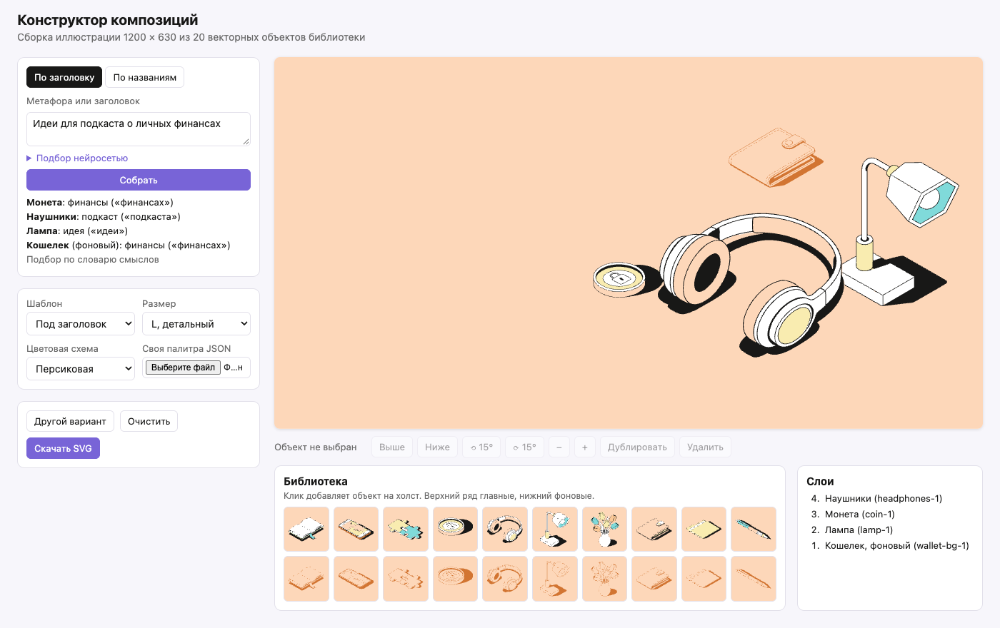
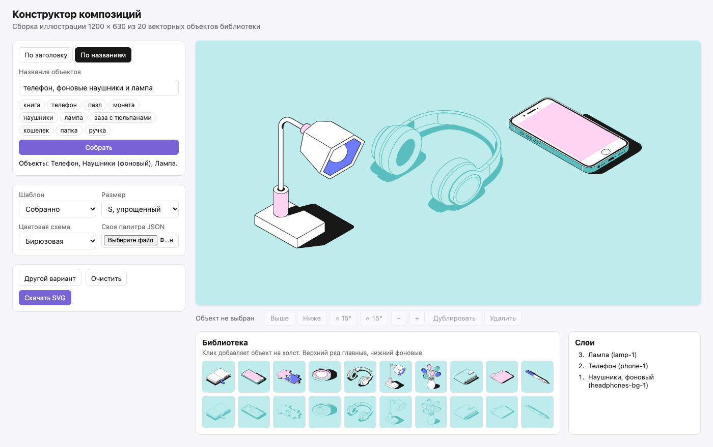

# Конструктор композиций из SVG-иллюстраций

Веб-сервис собирает иллюстрацию 1200 × 630 из 20 готовых векторных объектов библиотеки (10 главных цветных и 10 фоновых монохромных, каждый в размерах L и S). Композиция собирается по заголовку или метафоре, либо по списку названий объектов. Дальше ее можно править в редакторе, перекрасить в одну из цветовых схем или в свою палитру из JSON и скачать векторным SVG.

Стенд: https://nata2627.github.io/illustration-composer/

## Демонстрация

| Сценарий 1, по заголовку | Сценарий 2, по названиям | Шаблон «со смещением» |
|---|---|---|
|  |  |  |
| «Идеи для подкаста о личных финансах», схема персиковая, размер L | «телефон, фоновые наушники и лампа», бирюзовая, S | «Командная работа над проектом и договор с банком», сиреневая, L |

Готовые файлы этих композиций лежат в `examples/`. Каждую можно открыть на стенде ссылкой с параметрами `?mode=&q=&tpl=&palette=&size=`, `npm run examples` пересобирает файлы и печатает ссылки.

## Что умеет

- Сценарий 1: заголовок или метафора. Сервис подбирает 1-3 главных объекта и до 2 фоновых и пишет под формой, почему выбран каждый («Лампа: идея («идеи»)»). Подбирает словарь смыслов, а если ввести ключ Anthropic API, то языковая модель, которая понимает смысл всей фразы. Если модель недоступна или в словаре нет совпадений, сервис так и пишет и показывает запасной вариант.
- Сценарий 2: список названий в свободной форме: «наушники, лампу и фоновую книгу». Понимает падежи, синонимы (смартфон, бумажник, тюльпаны) и одну опечатку в слове. Слово «фоновый» перед названием берет монохромный вариант. Есть чипы с названиями всех объектов.
- Три шаблона раскладки по фреймам SVG-drop из макета: «Под заголовок» (левая половина свободна), «Со смещением», «Собранно». Раскладка повторяет приемы дизайнера: телефон лежит на книге, пазл на телефоне, лампа сзади, ручка спереди. Кнопка «Другой вариант» меняет порядок объектов, тот же ввод всегда дает ту же картинку.
- Редактор: добавить объект из библиотеки, выделить, перетащить мышью или стрелками, повернуть на 15°, изменить размер, дублировать, удалить, поднять или опустить слой, список слоев.
- Размер L или S: при переключении подгружается другой набор объектов из Figma (разная детализация), сцена сохраняется.
- Цветовая схема: три схемы из макета и загрузка своей палитры JSON.
- Экспорт SVG: каждый объект отдельной группой `<g id="lamp-1">` с исходными путями, фон отдельным `<rect id="background">`.

## Архитектура

```
Figma REST API ──> assets/fetch_figma.py ──> assets/figma/ (svg каждого узла, file.json; вне git)
                                                   │
                          scripts/build-library.mjs (npm run build:lib)
                                                   │
               public/library/L.json, S.json      src/data/palettes.json      src/data/objects.json
               (пути объектов)                     (схемы по ролям)            (названия, смыслы, масштаб)
                         │                                 │                          │
                         └──────── scene (слои) ── layout (шаблоны) ── match и llm (сценарии 1 и 2)
                                                   │
                                     render.ts: sceneToSvg ──> холст на странице и файл SVG
```

### Хранение

`scripts/build-library.mjs` берет SVG, которые выгрузил из Figma скрипт `assets/fetch_figma.py`, и пишет по одному JSON на размер: `public/library/L.json` и `S.json`, около 700 КБ каждый. Для каждого из 10 объектов там два варианта (`main` и `bg`) с размерами, `viewBox` и телом SVG. Тело это исходные элементы `<path>` из Figma без изменений; удаляются только атрибуты `id` слоев Figma (`Vector_51`), иначе две копии одного объекта дали бы повторяющиеся id. Скрипт проверяет, что в объектах нет `defs`, `clipPath`, `mask`, градиентов и ссылок `url(#...)`, для которых id нужны.

Таблица узлов Figma (какой id это какой объект) записана в скрипте явно. Ваза, а в размере S еще книга, папка и ручка лежат в Figma безымянными группами (`Group 2136136344`), их я определила по положению на фрейме. У книги размера L маленькая белая заплатка лежит рядом с группой, вне ее; скрипт возвращает ее первым путем группы из `fillGeometry` того же узла, как в размере S.

### Извлечение

Страница при старте загружает `L.json`, при переключении на S загружает `S.json` (кэшируется). Метаданные объектов (`src/data/objects.json`) и палитры входят в сборку.

### Перекраска

Все 40 объектов библиотеки нарисованы в сиреневой схеме, и в них встречаются только 8 цветов этой схемы (тест проверяет это для каждого объекта). Поэтому каждый цвет объекта однозначно определяет свою роль в палитре: `bg1`, `bg2`, `bg3`, `ink` (цвета фона, включая черный контур) и `obj1`, `obj2`, `obj3`, `paper` (цвета объектов, включая белый). Перекраска строит таблицу «цвет исходной схемы ──> цвет той же роли в целевой схеме» и заменяет значения атрибутов `fill` и `stroke`. Геометрия и порядок элементов не меняются; тест сравнивает все `d` до и после.

Палитра это данные, новая схема добавляется в `palettes.json` или загружается файлом в интерфейсе (формат такой же, как у элемента списка `palettes`; файл проверяется на все 8 ролей).

Правило макета «цвета объектов не используются в фонах» выполняется так: фон холста берет `bg1`, фоновые объекты в исходнике состоят только из `bg1` и `bg3` и после перекраски получают только цвета фона целевой схемы. Тест проверяет это для всех схем и обоих размеров.

### Раскладка

Правила `layout.ts` сняты с шести фреймов SVG-drop: координаты объектов взяты из `file.json` выгрузки Figma, а не на глаз.

- Объекты стоят в ряд, соседи заходят друг на друга на 8% ширины более узкого. Центры обычных объектов на одной высоте (у книги и наушников в фрейме «Собранно L» они совпадают до пикселя).
- Высокий объект (лампа, ваза) стоит в конце ряда и дальше от зрителя: его центр выше на 0,36 его высоты. Ручка лежит спереди: центр ниже ряда на 0,71 ее высоты, конец выходит за ряд на 0,1 ее длины.
- Плоские объекты кладутся друг на друга: телефон на книгу или папку, пазл или монета на телефон. Во фреймах и «телефон на книге», и «пазл на телефоне» лежат в одной и той же точке носителя: 0,49-0,57 по ширине, 0,35-0,37 по высоте.
- В фреймах размера S телефон стоит не в ряду, а прямо за наушниками. Так же ставится плоский объект, который заметно уже самого широкого объекта ряда, если в ряду три объекта и больше.
- «Со смещением» это та же сцена в обратном порядке: лампа и ручка у левого края. Сами объекты не отражаются, изометрия остается как нарисована.
- Фоновые объекты на 20% мельче главных и стоят рядом за основным, из-за переднего ряда видна половина заднего. Больше четырех позиций идут в два ряда: высокие и крупные назад, мелкие вперед.

Затем группа равномерно масштабируется и вписывается в область шаблона. На том же наборе объектов, что во фрейме «Собранно L», размеры совпадают с макетом: книга 530 px против 529, наушники 365 против 365, лампа 243 против 243, ручка 302 против 302. Это проверяет тест. Порядок объектов задает генератор случайных чисел с зерном от хеша ввода, поэтому раскладка детерминирована. Еще один тест прогоняет 600 случайных сцен и проверяет, что все объекты на холсте.

В фреймах SVG-drop дизайнер ставил объекты в разном масштабе: лампа меньше натурального размера библиотеки, ручка больше. Эти поправки (`scale` в `objects.json`) измерены на фреймах «Собранно» как ширина объекта на холсте к ширине в библиотеке, относительно книги. Для монеты, кошелька, вазы и папки в фреймах SVG-drop образцов нет, их значения подобраны на глаз.

### Подбор по метафоре

У каждого объекта словарь основ слов и смыслов (`лампа: иде ──> идея, вдохнов ──> вдохновение`, около 20 на объект). Слова заголовка сравниваются с основами по началу слова, прямое название объекта весит больше. Если к слову подходят основы разных объектов, берется самая длинная: «командировка» это поездка, а не «команда». Три объекта с наибольшим счетом становятся главными, следующие два фоновыми. Способ работает без ключей и без сети, и выбор всегда можно объяснить. Тест прогоняет 10 заголовков из `tests/fixtures/headlines.json`. В заголовках опечатки не допускаются: на расстоянии одной буквы от названий объектов оказываются обычные слова («ваша» и «ваза», «папа» и «папка»). В сценарии 2, где названия вводят нарочно, одна опечатка разрешена.

Качество словаря измерено на 90 заголовках из `tests/fixtures/headlines-eval.json`. У каждого заголовка список объектов, которые подходят к нему по смыслу, а инструкция разметки лежит в том же файле. Заголовки разделены на две части: по 60 рабочим словарь дополнялся, 30 контрольных в работе не использовались и только измерялись. Считается попадание (хотя бы один главный объект из списка подходящих) и точность (доля подходящих среди выбранных главных). `npm run eval` пересчитывает, результаты в `results/`.

| | Рабочие, до | Рабочие, после | Контрольные, до | Контрольные, после |
|---|---|---|---|---|
| Совпадение нашлось | 50 из 60 | 60 из 60 | 25 из 30 | 26 из 30 |
| Попадание | 45 из 60 | 60 из 60 | 24 из 30 | 25 из 30 |
| Точность главных | 53 из 60 | 71 из 77 | 37 из 38 | 38 из 39 |

Рост на рабочих заголовках это подгонка: словарь дополнялся именно по их промахам. Реальную картину показывают контрольные: 25 из 30, и в 4 заголовках из 30 словарь не находит ни одного знакомого слова. Это предел словарного подхода, следующий шаг описан в режиме с моделью ниже.

С ключом заголовок разбирает модель Claude (`src/llm.ts`). В системном промпте каталог из 10 объектов с примерами смыслов, ответ ограничен JSON-схемой (structured outputs): массивы главных и фоновых объектов и причина для каждого, а id объекта может быть только из библиотеки. Ответ проверяется еще раз в коде: не больше 3 главных и 2 фоновых, без повторов, объект не бывает одновременно главным и фоновым. Причины модели экранируются перед выводом на страницу. При любой ошибке (неверный ключ, сеть, отказ модели, неразобранный ответ) показывается подбор по словарю и понятное сообщение.

Отдельного сервера нет, поэтому запрос идет из браузера напрямую в Anthropic API с ключом пользователя. Ключ лежит в `sessionStorage` этой вкладки и никуда больше не отправляется. Для публичного стенда это нормально: каждый платит своим ключом. Встроенный ключ в статическом сайте был бы виден любому. SDK и схема грузятся отдельным файлом (около 110 КБ в gzip) только после первого запроса к модели, основная страница остается около 10 КБ.

## Ограничения и что не получилось

- Без ключа подбор по метафоре словарный: понимает слова из словаря и их формы, но не смысл фразы без опорных слов («как не выгореть» даст набор по умолчанию).
- Режим с моделью проверен тестами на подставном клиенте и в браузере на подставных ответах API: 401, корректный ответ, экранирование. Качество подбора моделью на наборе заголовков не измерялось.
- Раскладка построена на правилах из шести фреймов, а в них всего 6 объектов из 10. Для вазы, кошелька и монеты правил дизайнера нет, они ставятся по общим правилам. Сцены из 7-10 объектов получаются плотными.
- Поворот на произвольный угол поворачивает изометрический объект в плоскости картинки, так что пользоваться им стоит аккуратно; в автосборке поворот не используется.
- Декоративные фоны из макета (конфетти, линии) в сервис не вошли.
- Повторный запрос к API Figma за отдельными узлами получил ответ 429 (лимит запросов), поэтому заплатка книги взята из `file.json`.

## Запуск

```
npm install
npm run dev          # локально, http://localhost:5173/illustration-composer/
npm run check        # tsc, тесты vitest, сборка
npm run build:lib    # пересобрать библиотеку из выгрузки Figma (нужен assets/figma/)
npm run examples     # пересобрать examples/
```

Выгрузка из Figma: токен в `~/.figma_token`, затем `FIGMA_FILE_KEY=<ключ файла> python3 assets/fetch_figma.py`.

Стенд собирается GitHub Actions (`.github/workflows/pages.yml`) при push в `main`.

## Стек

Vite, TypeScript, Vitest, Anthropic TypeScript SDK и Zod (режим с моделью), Figma REST API, GitHub Actions, GitHub Pages.
